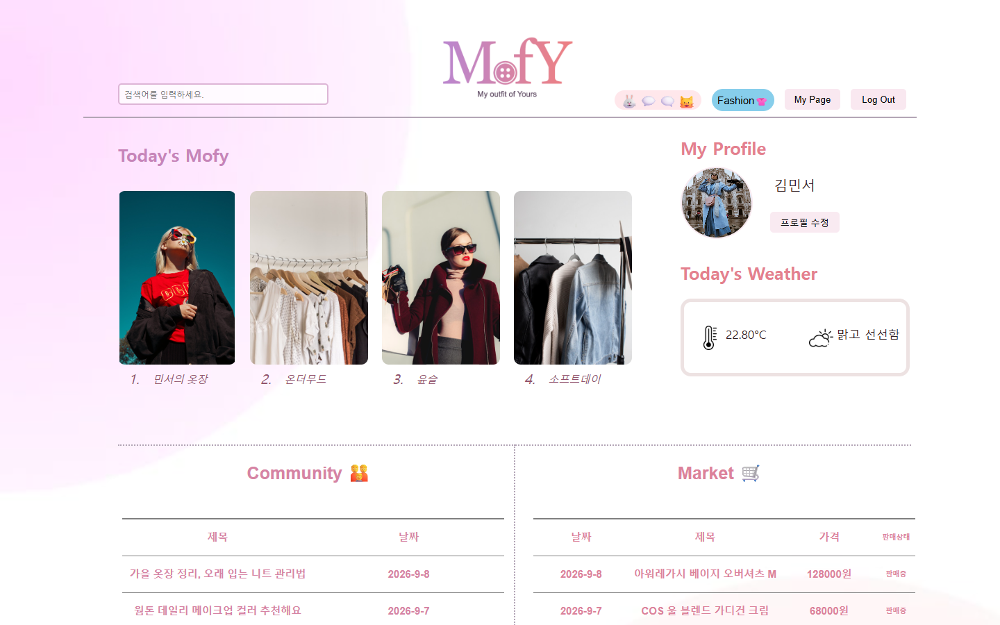
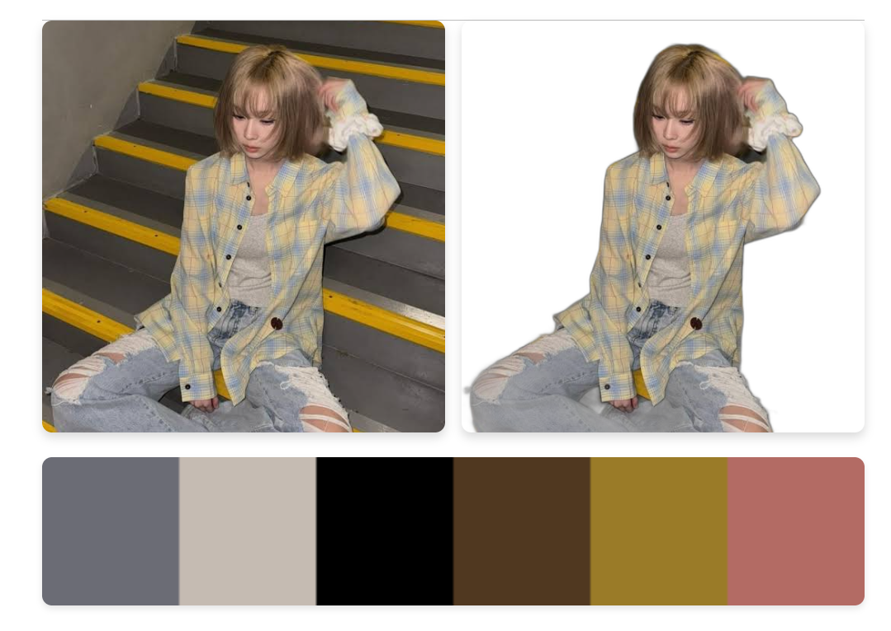
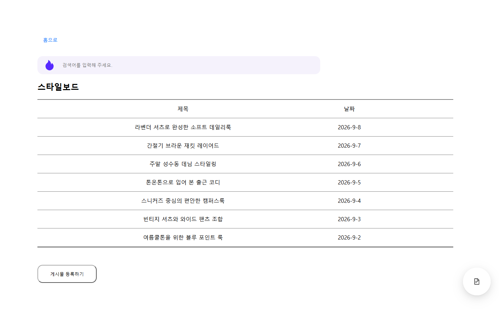
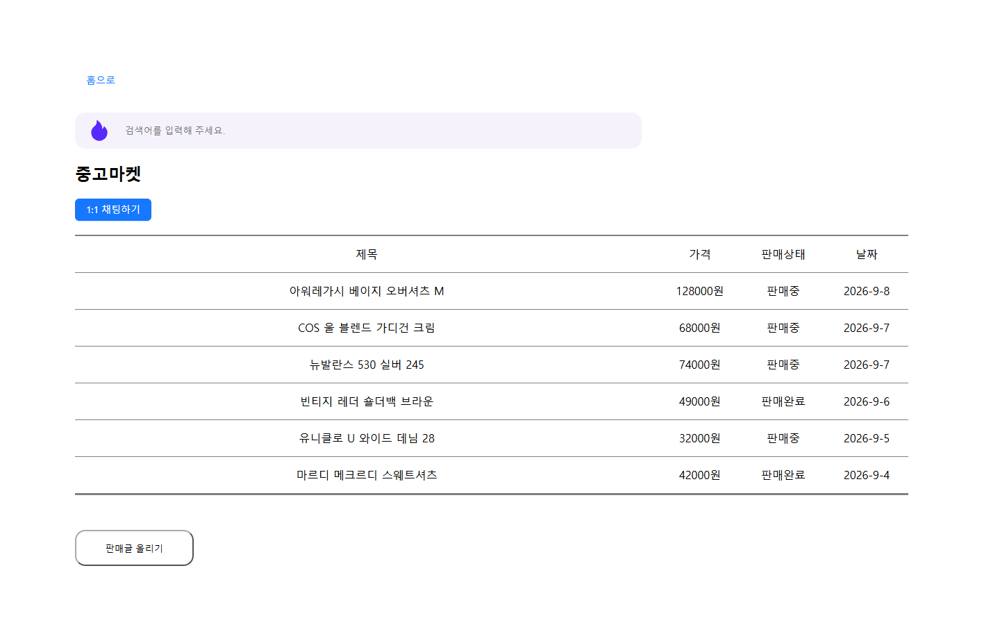
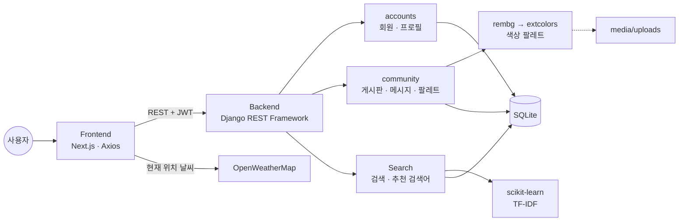

# MOFY · 색상 팔레트 추출과 메시지를 제공하는 패션 커뮤니티

> 패션 이미지를 공유하고 중고 의류를 거래하며, 이미지의 배경을 제거해 의상 색상 팔레트를 보여주는 7인 팀 프로젝트입니다.
> 이 중 사용자 간 메시지 작성·조회 API와 React 화면을 팀원과 공동 구현했습니다.



| 기간 | 팀 구성 | 내 역할 |
| :-- | :-- | :-- |
| 2023.09 ~ 2023.11 | 7인 팀 (팀 저장소 fork) | 사용자 메시지 기능 공동 구현 (DRF API · React 화면) |

**링크** · [포트폴리오 상세](https://portfolio-sys13-9a4d.vercel.app/projects/mofy)

<br>

## 주요 기능

`구분`이 **공동 구현**인 항목이 제가 참여한 부분이고, 나머지는 팀 전체가 만든 서비스 기능입니다.

| 기능 | 설명 | 구분 |
| :-- | :-- | :-- |
| 사용자 메시지 | 수신자 아이디로 메시지를 보내고, 보낸 메시지함·받은 메시지함에서 목록을 확인 | 공동 구현 |
| 이미지 색상 팔레트 | `rembg`로 배경을 제거한 뒤 `extcolors`로 주요 색상을 추출해 팔레트 이미지로 제공 | 팀 |
| 스타일 보드 (OOTD) | 데일리룩 게시물 공유, 좋아요·댓글, 홈 화면의 스타일 랭킹 | 팀 |
| 중고 마켓 | 가격·판매 상태·지역을 가진 거래글, `boardType`으로 일반 글과 구분 | 팀 |
| 커뮤니티 | 자유 게시판, 게시글 신고와 신고 목록 | 팀 |
| 검색 | 제목·태그 기반 게시글 검색, 검색 기록 기반 인기 검색어, TF-IDF 코사인 유사도 기반 연관 검색어 | 팀 |
| 현재 날씨 | 사용자 위치로 OpenWeatherMap을 조회해 홈 화면에 기온·날씨 표시 | 팀 |
| 회원·프로필 | SimpleJWT 로그인, 아이디 찾기·비밀번호 재설정, 키·몸무게·신발 사이즈와 선호 스타일 관리 | 팀 |

색상 팔레트는 사진 속 의상의 주요 색을 보여주는 기능이며, 퍼스널 컬러 계절형을 진단하는 기능은 아닙니다.
연관 검색어는 개인별 기록이 아니라 전체 사용자의 누적 검색어를 기준으로 계산합니다.

| 컬러 팔레트 | 스타일 보드 | 중고 마켓 |
| :-: | :-: | :-: |
|  |  |  |

<br>

## 내가 맡은 부분

### 사용자 메시지 기능 (팀원과 공동 구현)

사용자끼리 메시지를 작성하고 확인하는 백엔드 API와 화면 흐름을 팀원과 함께 구현했습니다.
중고 마켓의 `1:1 채팅하기` 버튼에서 메시지 메뉴로 들어가 메시지 쓰기, 보낸 메시지함, 받은 메시지함으로 이동합니다.

| 메서드 | 경로 | 동작 |
| :-- | :-- | :-- |
| `POST` | `/chat/` | `receiveID`(수신자 아이디)로 사용자를 찾아 로그인 사용자를 발신자로 메시지 저장 |
| `GET` | `/message_box/1/` | 로그인 사용자가 보낸 메시지 목록 |
| `GET` | `/message_box/2/` | 로그인 사용자가 받은 메시지 목록 |
| `GET` | `/message_detail/<id>/` | 메시지 단건 조회 |

- 모든 메시지 API는 `JWTAuthentication` + `IsAuthenticated`로 로그인 사용자만 호출할 수 있습니다.
- 프론트엔드는 쿠키의 `access_token`을 `Authorization: Bearer` 헤더에 담아 Axios로 호출하고, 응답을 목록으로 렌더링합니다.
- 화면을 실제 API에 연결했습니다.
  보낸 메시지함의 임시 URL을 `/message_box/1/`로 바꾸고, 더미 데이터로 그리던 받은 메시지함을 `/message_box/2/` 응답으로 교체했으며, `/chat/` 전송 요청에 JWT 헤더를 추가했습니다.

관련 코드

- API: [`backend/community/views.py`](backend/community/views.py) (`Chat`, `MessageBox`, `MessageDetail`)
- 모델·직렬화: [`backend/community/models.py`](backend/community/models.py) (`Message`), [`backend/community/serializers.py`](backend/community/serializers.py)
- 화면: [`frontend/src/message/`](frontend/src/message/) (`messageInput.js` 작성, `sendMessage.js` 보낸 메시지함, `getMessage.js` 받은 메시지함, `select.js` 메뉴)

### 저장소 정리 (사후, 2025.03)

- 팀 백엔드 코드를 이 저장소의 `backend/`로 옮겨 오고 `.gitignore`를 정리했습니다.
- 앱별로 누적된 마이그레이션 파일을 `0001_initial.py`로 다시 생성했습니다.
- `backend/README.md` 설치 목록에 `onnxruntime`을 추가하고, 프론트엔드 의존성 버전(`next`, `react-router-dom`)을 조정했습니다.

<br>

## 설계 포인트 (팀)

아래는 팀이 서비스에 적용한 설계입니다. 제가 직접 설계·구현한 부분은 아닙니다.

### 1. 배경 제거 후 색상 추출

- **문제** 사진을 그대로 색상 추출에 넣으면 배경색이 상위 팔레트를 차지해 의상 색이 밀립니다.
- **해결** 업로드 이미지 → `rembg` 배경 제거 → `extcolors` 주요 색상 추출 → 같은 폭의 색상 블록으로 팔레트 이미지 생성 순서로 처리합니다. 원본·배경 제거 결과·팔레트 이미지를 `PhotoSave`에 함께 저장합니다.
- **결과** 배경색의 영향을 줄여 사진 속 의상 색을 중심으로 팔레트를 보여줍니다.
- 코드: [`backend/community/views.py`](backend/community/views.py) (`pal_crt`, `Test`), [`frontend/src/colorPalette/`](frontend/src/colorPalette/)

### 2. `boardType`으로 게시판 분리

- **선택** 자유·패션·거래 게시판을 별도 테이블로 나누지 않고, 하나의 `Board`에 `boardType`(SmallInteger)을 두어 구분했습니다. 프론트엔드는 `/boardType/1|2|3/`으로 커뮤니티·스타일 보드·중고 마켓 목록을 가져옵니다.
- **이유** 제목·본문·이미지·좋아요·댓글은 세 타입이 모두 공유하므로 목록 조회와 댓글·좋아요 로직을 한 벌만 유지하면 됩니다.
- **대가** `price`, `state`, `address`처럼 특정 타입에서만 쓰는 필드가 다른 타입에서는 기본값이나 빈 값으로 남습니다. 타입별 속성이 늘어나면 별도 테이블이나 하위 타입 분리를 검토할 지점입니다.
- 코드: [`backend/community/models.py`](backend/community/models.py) (`Board`)

<br>

## 기술 스택

| 구분 | 기술 |
| :-- | :-- |
| Frontend | Next.js `^12.1.0` (React `17.0.2`), Emotion(`@emotion/styled`), Ant Design `^5.9.0`, Axios `^1.5.1`, js-cookie |
| Backend | Python 3.9+, Django REST Framework, SimpleJWT, django-cors-headers (Django 4.1로 생성한 프로젝트) |
| Data | SQLite, 업로드 이미지는 로컬 `media/` |
| 이미지 처리 | rembg (+ onnxruntime), Pillow, extcolors |
| 검색 | scikit-learn (`TfidfVectorizer`), NumPy |
| 외부 API | OpenWeatherMap |

프론트엔드 버전은 [`frontend/package.json`](frontend/package.json) 기준입니다. 백엔드는 버전을 고정한 requirements 파일이 없고, 설치 패키지는 [`backend/README.md`](backend/README.md)에 정리되어 있습니다.

<br>

## 아키텍처



- Django API가 회원, 게시판·메시지, 이미지 처리, 검색어 계산을 담당하고 Next.js 화면은 API 결과와 날씨 정보를 렌더링합니다.
- 인증은 SimpleJWT 토큰(access 1시간, refresh 7일)을 쿠키에 저장해 요청 헤더로 보냅니다.
- 데이터는 SQLite, 업로드·팔레트 이미지는 로컬 `media/uploads`에 저장하는 개발용 구성입니다.

<br>

## 실행 방법

프론트엔드가 API 주소를 `http://127.0.0.1:8000`(일부 `localhost:8000`)으로 직접 호출하고, 백엔드 CORS가 `http://localhost:3000`만 허용하므로 두 서버를 기본 포트로 실행해야 합니다.

### 1. 백엔드 (Django)

```bash
cd backend
python -m venv venv
source venv/bin/activate        # Windows: venv\Scripts\activate

pip install django-rest-framework djangorestframework-simplejwt django-cors-headers \
            django-rest-authtoken django-multiselectfield channels \
            scikit-learn extcolors rembg onnxruntime

python manage.py makemigrations
python manage.py migrate
mkdir -p media/uploads          # 팔레트 처리 결과 저장 경로 (media/는 .gitignore 대상)
python manage.py runserver      # http://localhost:8000
```

설치 중 누락된 라이브러리 오류가 나면 해당 패키지를 추가로 설치합니다. ([`backend/README.md`](backend/README.md))

### 2. 프론트엔드 (Next.js)

```bash
cd frontend
yarn install
yarn dev                        # http://localhost:3000
```

홈 화면의 날씨를 보려면 `frontend/.env`에 아래 변수를 설정합니다. (`.env`는 `.gitignore`에 포함)

| 변수 | 용도 |
| :-- | :-- |
| `NEXT_PUBLIC_OPEN_WEATHER_MAP_API_KEY` | OpenWeatherMap 현재 날씨 조회 |

서버 실행 후 `http://localhost:3000/mainPage`로 접속합니다.

> **알려진 제한** 현재 저장소에서는 프론트엔드가 `/palcreate/`를 호출하지만 백엔드 팔레트 API는 `/Test/`로 등록되어 있어([`backend/community/urls.py`](backend/community/urls.py)), 그대로 실행하면 컬러 팔레트 화면이 동작하지 않습니다.

<br>

## 폴더 구조

```
Mofy/
├── backend/                 # Django REST API
│   ├── drfProject/          # settings, 루트 URL
│   ├── accounts/            # 회원가입·로그인(JWT), 아이디·비밀번호 찾기, 프로필·신체 정보
│   ├── community/           # 게시판(boardType), 댓글·좋아요·신고, 스타일 랭킹, 메시지, 색상 팔레트
│   └── Search/              # 게시글 검색, 검색 기록, 인기·연관 검색어
├── frontend/                # Next.js
│   ├── pages/               # 라우트 (mainPage, styleBoard, marketBoard, community, colorPalette, mks/ ...)
│   ├── src/                 # 화면 컴포넌트 (message/, colorPalette/, styleBoard/, marketBoard/ ...)
│   └── styles/              # 페이지별 스타일
└── docs/images/             # README 이미지
```
